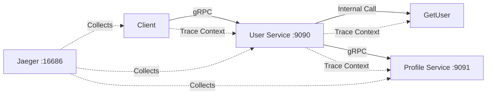

# 🎯 OpenTelemetry Context Propagation Over gRPC
## A Complete Guide for Engineering Teams

---

## 📚 Table of Contents

1. [What is Context Propagation?](#what-is-context-propagation)
2. [Why It Matters](#why-it-matters) 
3. [How It Works](#how-it-works)
4. [Demo Architecture](#demo-architecture)
5. [Code Walkthrough](#code-walkthrough)
6. [Running the Demo](#running-the-demo)
7. [Key Takeaways](#key-takeaways)
8. [Q&A](#qa)

---

## 🤔 What is Context Propagation?

**Context Propagation** is the mechanism that allows **trace context** (trace ID, span ID, and other metadata) to flow seamlessly across service boundaries in a distributed system.

### Without Context Propagation 😞
```
Service A ---> Service B ---> Service C
[Trace 123]    [Trace 456]    [Trace 789]
```
❌ Each service creates separate traces
❌ No correlation between related operations
❌ Debugging distributed issues is impossible

### With Context Propagation 🎉
```
Service A ---> Service B ---> Service C
[Trace 123] -> [Trace 123] -> [Trace 123]
```
✅ Single trace spans multiple services
✅ Complete request flow visibility
✅ Easy debugging and performance analysis

---

## 🎯 Why It Matters

### 1. **Distributed Debugging**
- Track a request from frontend to database
- See exactly where latency occurs
- Identify failed operations across services

### 2. **Performance Monitoring**
- Measure end-to-end latency
- Find bottlenecks in service interactions
- Optimize critical paths

### 3. **Service Dependencies**
- Understand service call patterns
- Identify tight coupling
- Plan capacity and scaling

### 4. **Error Correlation**
- Connect errors across service boundaries
- Understand failure propagation
- Improve error handling strategies

---

## ⚙️ How It Works

### 1. **Context Creation**
```go
// Client starts a trace
ctx, span := tracer.Start(ctx, "user_operation")
defer span.End()
```

### 2. **Context Injection** (gRPC Client)
```go
// OTel interceptor automatically injects trace context into gRPC metadata
grpc.WithUnaryInterceptor(otelgrpc.UnaryClientInterceptor())
```

### 3. **Context Extraction** (gRPC Server)
```go
// OTel interceptor automatically extracts trace context from gRPC metadata
grpc.UnaryInterceptor(otelgrpc.UnaryServerInterceptor())
```

### 4. **Context Usage**
```go
// Server continues the trace
func (s *Server) HandleRequest(ctx context.Context, req *Request) {
    // ctx already contains the propagated trace context!
    ctx, span := tracer.Start(ctx, "handle_request") // Child span
    defer span.End()
    
    // Call another service - context propagates automatically
    s.otherService.DoSomething(ctx, data)
}
```

---

## 🏗️ Demo Architecture



### Services:
- **Client**: Initiates requests with trace context
- **User Service**: Main business service, calls Profile Service
- **Profile Service**: Secondary service that receives propagated context
- **Jaeger**: Collects and visualizes all traces

---

## 💻 Code Walkthrough

### 1. **OTel Setup** (`internal/otel/tracer.go`)

```go
func InitTracer(serviceName string) (*trace.TracerProvider, error) {
    // Create Jaeger exporter
    exporter, err := jaeger.New(jaeger.WithCollectorEndpoint(...))
    
    // Create tracer provider with service info
    tp := trace.NewTracerProvider(
        trace.WithBatcher(exporter),
        trace.WithResource(resource.NewWithAttributes(
            semconv.ServiceNameKey.String(serviceName),
        )),
    )
    
    // Set global propagator for context transmission
    otel.SetTextMapPropagator(propagation.NewCompositeTextMapPropagator(
        propagation.TraceContext{},
        propagation.Baggage{},
    ))
    
    return tp, nil
}
```

### 2. **Server Setup** (`cmd/user-service/main.go`)

```go
// Create gRPC server with OTel stats handler
s := grpc.NewServer(
    grpc.StatsHandler(otelgrpc.NewServerHandler()),
)
```

### 3. **Client Setup** (`cmd/client/main.go`)

```go
// Connect with OTel stats handler
conn, err := grpc.Dial("localhost:9090",
    grpc.WithStatsHandler(otelgrpc.NewClientHandler()), // 🔑 Auto-injects context
)
```

### 4. **Service Implementation** (`internal/server/user_server.go`)

```go
func (s *UserServer) GetUserProfile(ctx context.Context, req *pb.GetUserProfileRequest) (*pb.GetUserProfileResponse, error) {
    // Start new span - automatically becomes child of incoming span
    ctx, span := tracer.Start(ctx, "GetUserProfile",
        trace.WithAttributes(attribute.Int64("user.id", req.UserId)),
    )
    defer span.End()
    
    // Call another service - context propagates automatically! 🚀
    userResp, err := s.GetUser(ctx, &pb.GetUserRequest{Id: req.UserId})
    
    // Cross-service call - context flows over the network! 🌐
    profileResp, err := s.profileClient.GetProfile(ctx, &pb.GetProfileRequest{
        UserId: req.UserId,
    })
    
    return &pb.GetUserProfileResponse{
        User: userResp.User,
        Profile: profileResp.Profile,
    }, nil
}
```

---

## 🚀 Running the Demo

### Quick Start

```bash
# 1. Setup (install dependencies, generate protobuf)
chmod +x setup.sh && ./setup.sh

# 2. Start Jaeger
docker run -d --name jaeger \
  -p 16686:16686 -p 14268:14268 \
  jaegertracing/all-in-one:latest

# 3. Run the demo
chmod +x run-demo.sh && ./run-demo.sh
```

### Manual Steps (for live demo)

```bash
# Terminal 1: Profile Service
go run cmd/profile-service/main.go

# Terminal 2: User Service  
go run cmd/user-service/main.go

# Terminal 3: Client
go run cmd/client/main.go

# Browser: Jaeger UI
open http://localhost:16686
```

### Understanding the Basics

```bash
# Start with the basics demo
go run examples/context-propagation-basics/main.go
```

---

## 🎓 Key Takeaways

### 1. **Automatic Propagation**
- OTel gRPC interceptors handle context injection/extraction automatically
- No manual header manipulation needed
- Works transparently across service boundaries

### 2. **Span Hierarchy**
```
Client Request (Root Span)
├── UserService.GetUserProfile
│   ├── UserService.GetUser
│   └── ProfileService.GetProfile
```

### 3. **Business Context**
```go
span.SetAttributes(
    attribute.String("user.email", user.Email),
    attribute.Int64("order.amount", orderTotal),
)

span.AddEvent("payment.processed", trace.WithAttributes(
    attribute.String("payment.id", paymentId),
))
```

### 4. **Error Tracking**
```go
if err != nil {
    span.RecordError(err)
    span.SetStatus(codes.Error, "Payment failed")
    return err
}
```

---

## 🤔 Common Questions

### Q: How much overhead does tracing add?
**A:** Minimal with proper sampling. Production typically uses 1-5% sampling.

### Q: What if a service doesn't have OTel instrumentation?
**A:** The trace stops there, but downstream services can start new traces.

### Q: How do we handle sensitive data in traces?
**A:** Use attribute filtering and avoid logging PII directly.

### Q: Can we propagate custom data?
**A:** Yes! Use OpenTelemetry Baggage for custom key-value data.

### Q: What about other protocols (HTTP, messaging)?
**A:** OTel has interceptors/middleware for most protocols.

### Q: How do we debug context propagation issues?
**A:** Check Jaeger for broken trace chains, verify interceptors are installed.

---

## 🛠️ Next Steps

### 1. **Add to Existing Services**
- Install OTel SDK
- Add interceptors to gRPC servers/clients
- Configure exporter (Jaeger, OTLP, etc.)

### 2. **Custom Instrumentation**
- Add business-specific attributes
- Create custom spans for important operations
- Add events for key business moments

### 3. **Advanced Features**
- Implement sampling strategies
- Add metrics collection
- Use trace data for SLO monitoring

### 4. **Production Considerations**
- Set up proper sampling
- Configure batch export
- Monitor exporter performance
- Set up alerting on trace data

---

## 📚 Resources

- **OpenTelemetry Go Docs**: https://opentelemetry.io/docs/instrumentation/go/
- **gRPC Instrumentation**: https://pkg.go.dev/go.opentelemetry.io/contrib/instrumentation/google.golang.org/grpc/otelgrpc
- **Jaeger Documentation**: https://www.jaegertracing.io/docs/
- **This Demo Repository**: https://github.com/wahyurudiyan/go-grpc-otel

---

**🎉 Thank you! Questions?**

*Happy Tracing! 🔍✨*
